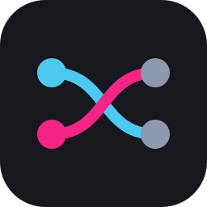

<p align="center">
  
</p>

<h1 align="center">Tidegate</h1>

<p align="center">
  Route and mix application audio on Linux.<br>
  Inputs on the left, outputs on the right, wires in between. Built on PipeWire.
</p>

<p align="center">
  <a href="https://github.com/OWNER/tidegate/actions/workflows/ci.yml"></a>
  
  
</p>

<!-- Add a screenshot: save it as docs/screenshot.png and uncomment the next line.
<p align="center"></p> -->

## Features

- **Per-connection volume and mute.** One input can feed several outputs, each
  with its own level: Discord loud in your headphones, silent on stream.
- **You decide every connection.** Nothing is wired for you unless you turn it on.
  Move a connection to another output, rename outputs, pick wire colors.
- **Live level meters** on every input and output.
- **Virtual microphone.** *Tidegate Stream* doubles as an input device called
  **Tidegate Microphone** that Discord, browsers and games list as a normal mic.
  **Mute mic** silences it.
- **Profiles.** Save the whole board (Gaming, Stream, Call) and switch with one
  click, `Ctrl+1..9`, the tray or the command line.
- **System tray.** Status icon with a red dot while the mic is muted, quick mute
  and profile menu; closing the window keeps Tidegate running.
- **Global shortcuts** through a small command line interface (see below).
- Optional: auto-add new apps, connect new inputs to the default output, start at
  login (minimized to the tray).
- Your board is remembered. All audio changes are undone when you quit.

## Install

Requires **PipeWire with `pipewire-pulse`** (default on CachyOS, Arch, Fedora,
Ubuntu 22.10+), **`pactl` and `parec`** (package `libpulse` / `pulseaudio-utils`)
and **PySide6**.

```sh
git clone https://github.com/OWNER/tidegate && cd tidegate
./install.sh              # for your user, to ~/.local
./install.sh --system     # system-wide, to /usr/local
./install.sh --uninstall
```

On Arch-based systems the installer installs missing dependencies with pacman.
Other distributions: install `pactl`/`parec` and PySide6 first, then run
`./install.sh --no-deps`. Make sure `~/.local/bin` is in your `PATH`.

An Arch `PKGBUILD` is in [`packaging/arch`](packaging/arch).

## Usage

1. **Add input** (top left): pick a running app or a microphone.
2. **Add output** (top right): pick a speaker, headphones or a virtual device.
3. Press **+** on an input card and choose an output. A wire appears. Use a
   connection's **⋮** (or right-click) to move or remove it.
4. For a call or stream: connect your microphone (and anything else the other side
   should hear) to **Tidegate Stream**, then pick **Tidegate Microphone** as the
   input device in Discord, your browser or any other app. Do not route the app
   that *receives* the call into Tidegate Stream, or the other side hears itself.
5. In OBS you can instead capture **Monitor of Tidegate Record**.

An app only shows up in the list once it has opened an audio stream (for example
when a video is playing). After you add it, it stays on the board, dimmed while idle.

### Global shortcuts

Wayland does not let apps grab global keys, so Tidegate exposes commands that you
bind in your desktop's shortcut settings (KDE: *System Settings → Keyboard →
Shortcuts → Add Command*):

| Command | Does |
| --- | --- |
| `tidegate --mic-mute` | toggle *Mute mic* |
| `tidegate --profile Gaming` | switch to the profile "Gaming" |
| `tidegate --show` / `--quit` | show the window / quit |
| `tidegate --minimized` | start hidden in the tray |

In the window: `Ctrl+M` toggles *Mute mic*, `Ctrl+1` to `Ctrl+9` pick profiles.

## How it works

Tidegate only uses `pactl` and `parec`; it needs no daemon and no root.

- Each input on the board gets a null sink (its "bus"); the app's streams are
  moved onto it.
- Each wire is a `module-loopback` (20 ms) from that bus to an output. Its slider
  controls the volume of that loopback.
- *Tidegate Stream* is a null sink; *Tidegate Microphone* is a `module-remap-source`
  on its monitor, which is why apps list it as a real microphone.
- Meters read the monitor of each bus and output with a small `parec`.
- On exit every module Tidegate loaded is unloaded again.

Settings and the board live in `~/.config/tidegate/config.json`.

## Troubleshooting

| Problem | Try |
| --- | --- |
| An app is missing from *Add input* | It has to be playing audio once. Start playback, then open the menu again. |
| Added an app and it is silent | It is on its own bus now. Press **+** on its card and connect it to an output. |
| *Tidegate Microphone* is missing in Discord or the browser | Restart that app after Tidegate has started. Check with `pactl list short sources \| grep tidegate`. |
| No meter movement | Check that `parec` is installed (`libpulse`). |
| Leftover devices after a crash | `pactl list short modules \| grep -i tidegate`, then `pactl unload-module <id>` for each, or `systemctl --user restart pipewire-pulse`. |

## Limitations

- *Mute mic* silences Tidegate Microphone (everything sent to Tidegate Stream),
  not the physical devices.
- No audio effects yet (noise suppression, EQ, compressor).
- Output volumes are not saved by Tidegate (the system keeps them).

## Development

```sh
PYTHONPATH=src python -m tidegate           # run from the source tree
python -m unittest discover -s tests -v     # tests (no sound server needed)
```

See [CONTRIBUTING.md](CONTRIBUTING.md) and [CHANGELOG.md](CHANGELOG.md).

## License

[MIT](LICENSE)
