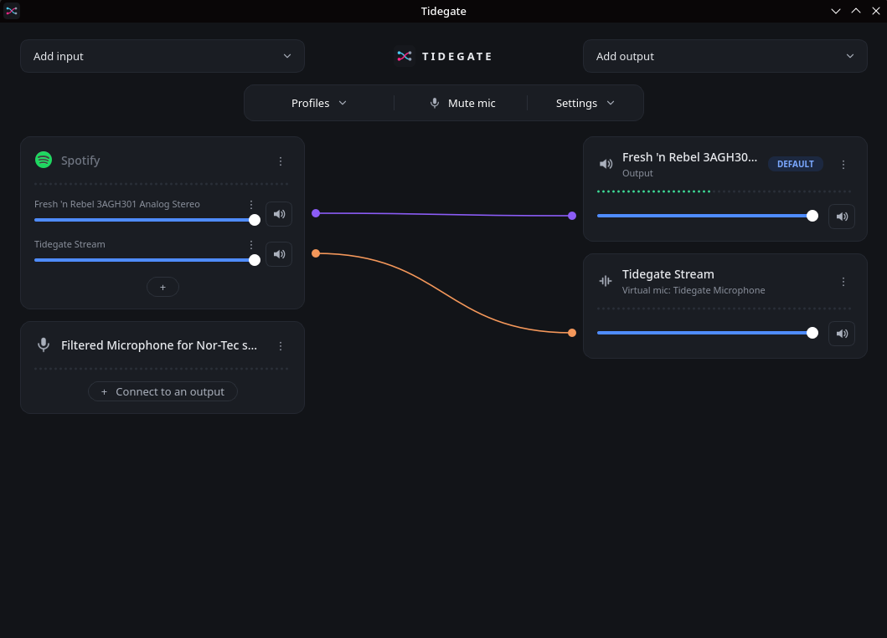
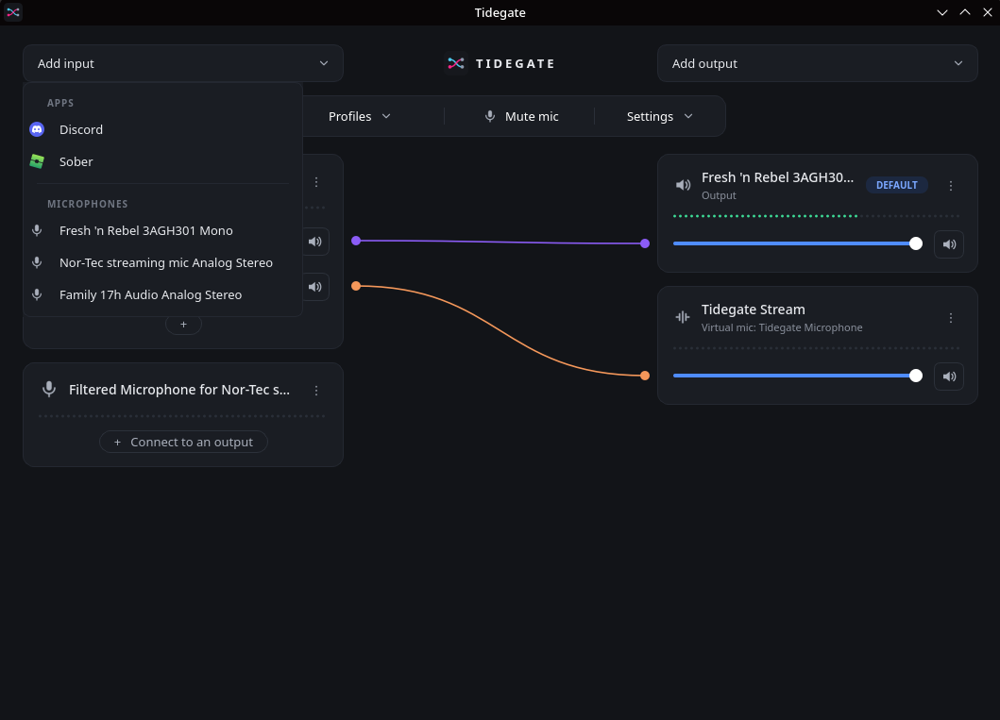
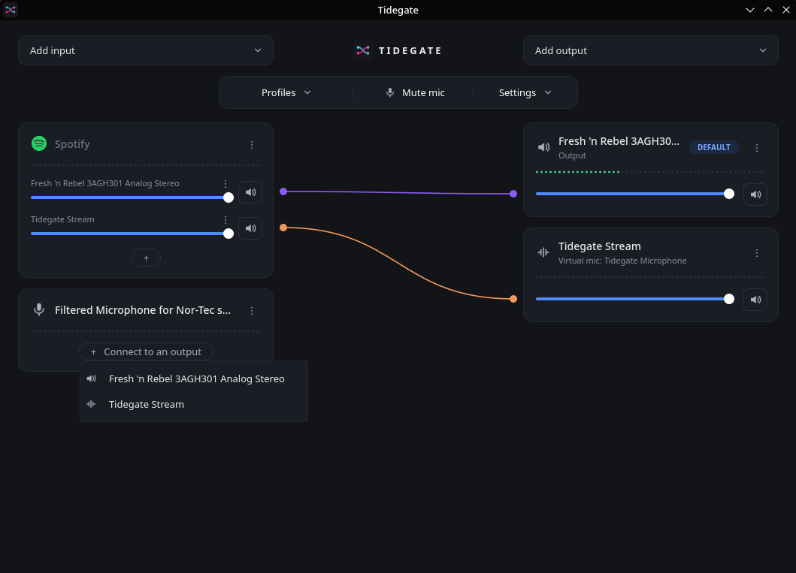
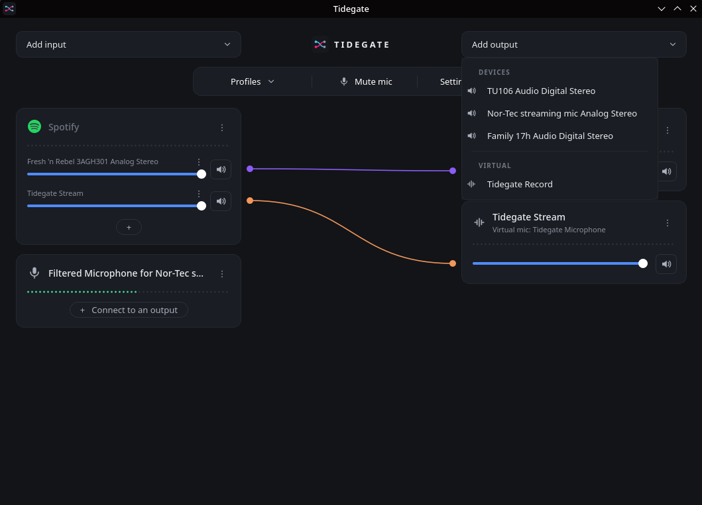

<p align="center">
  
</p>

<h1 align="center">Tidegate</h1>

<p align="center">
  <b>An open-source <a href="https://www.logitechg.com/en-us/software/mixline">MIXLINE</a> alternative for Linux.</b><br>
  Route and mix the audio of your apps and microphones with PipeWire.
</p>

<p align="center">
  <a href="https://github.com/abgeknallt/tidegate/actions/workflows/ci.yml"></a>
  <a href="https://github.com/abgeknallt/tidegate/releases"></a>
  
  
</p>

<p align="center">
  
</p>

<p align="center">
  <a href="#why-tidegate">Why</a> ·
  <a href="#install">Install</a> ·
  <a href="#quick-start">Quick start</a> ·
  <a href="#coming-from-mixline">Coming from MIXLINE</a> ·
  <a href="#shortcuts">Shortcuts</a> ·
  <a href="#troubleshooting">Troubleshooting</a>
</p>

## Why Tidegate

[MIXLINE](https://www.logitechg.com/en-us/software/mixline) is Logitech G's free audio routing and mixing app: add inputs
and outputs, connect them, set a volume per connection, and stream or record the
result. Logitech's [download page](https://www.logitechg.com/en-us/software/mixline) offers it for Windows only.

Tidegate brings that idea to Linux. It runs on PipeWire, needs no driver and no
root, and puts everything on one board: inputs on the left, outputs on the right,
a wire for every connection.

- **Per-connection volume and mute.** One input can feed several outputs, each with
  its own level: Discord loud in your headphones, silent on stream.
- **You decide every connection.** Nothing is wired for you unless you turn it on.
  Move connections between outputs, rename outputs, pick wire colors.
- **Virtual microphone.** *Tidegate Stream* doubles as an input called
  **Tidegate Microphone** that Discord, browsers and games list as a normal mic.
- **Live level meters** on every input and output.
- **Profiles.** Save the whole board (Gaming, Stream, Call) and switch in one click.
- **System tray** with mute status, quick mute and profile menu.
- **Real app icons** for Spotify, Discord, browsers and games.
- **Global shortcuts** through a small command line interface.

## Install

You need PipeWire with `pipewire-pulse` (default on CachyOS, Arch, Fedora and
Ubuntu 22.10+), `pactl` and `parec` (package `libpulse` or `pulseaudio-utils`), and
PySide6.

```sh
git clone https://github.com/abgeknallt/tidegate && cd tidegate
./install.sh              # for your user, to ~/.local
./install.sh --system     # system-wide, to /usr/local
./install.sh --uninstall
```

On Arch-based systems the installer installs missing dependencies with pacman. On
other distributions install `pactl`/`parec` and PySide6 first, then run
`./install.sh --no-deps`. Make sure `~/.local/bin` is in your `PATH`. An Arch
`PKGBUILD` is in [`packaging/arch`](packaging/arch).

## Quick start

1. **Add input** (top left): pick a running app or a microphone.
2. **Add output** (top right): pick speakers, headphones or a virtual device.
3. Press **+** on an input card and choose an output. A wire appears.
4. For a call or stream: connect your microphone and anything else the other side
   should hear to **Tidegate Stream**, then pick **Tidegate Microphone** as the
   input device in Discord, your browser or any other app.

Do not route the app that *receives* a call into Tidegate Stream, or the other side
hears itself. An app is listed once it has opened an audio stream, for example when
a video is playing. After you add it, it stays on the board, dimmed while idle.

<table>
  <tr>
    <td align="center" width="33%"><br><sub>Add an app or a microphone</sub></td>
    <td align="center" width="33%"><br><sub>Connect an input to any output</sub></td>
    <td align="center" width="33%"><br><sub>Pick devices or virtual outputs</sub></td>
  </tr>
</table>

## Coming from MIXLINE

The concepts carry over; the names are close on purpose.

| In MIXLINE | In Tidegate |
| --- | --- |
| Add input / Add output | **Add input** / **Add output** |
| Drag a route from an input to an output | Press **+** on the input and choose the output |
| Volume per route | Volume and mute per connection (the slider on each row) |
| `MIXLINE Stream` and `MIXLINE Record` outputs | **Tidegate Stream** (also a microphone, *Tidegate Microphone*) and **Tidegate Record** |
| Monitoring your own voice | Connect your microphone to your headphones output |
| Capture in OBS or Streamlabs | Capture **Monitor of Tidegate Record** or use *Tidegate Microphone* |

Tidegate is not a port or a copy of MIXLINE; it is an independent project with its
own code.

## Shortcuts

Wayland does not let apps grab global keys, so Tidegate exposes commands that you
bind in your desktop's shortcut settings (KDE: *System Settings → Keyboard →
Shortcuts → Add Command*).

| Command | Does |
| --- | --- |
| `tidegate --mic-mute` | toggle **Mute mic** (silences Tidegate Microphone) |
| `tidegate --profile Gaming` | switch to the profile "Gaming" |
| `tidegate --show` / `--quit` | show the window / quit |
| `tidegate --minimized` | start hidden in the tray |
| `tidegate --diagnose` | print audio setup info for bug reports |

In the window: `Ctrl+M` toggles **Mute mic**, `Ctrl+1` to `Ctrl+9` pick profiles.
Settings has options to auto-add new apps, connect new inputs to the default
output, use Tidegate Microphone as the default microphone, and start at login.

## How it works

Tidegate only uses `pactl` and `parec`: no daemon, no root.

- Each app on the board gets a null sink (its "bus") that collects its streams.
  Microphones are read directly.
- Each wire is a `module-loopback` (20 ms) from the input to an output; its slider
  sets that loopback's volume.
- *Tidegate Stream* is a null sink, and *Tidegate Microphone* is a
  `module-remap-source` on its monitor, which is why apps list it as a real mic.
- Meters read the monitor of each bus and output with a small `parec`.
- On exit every module Tidegate loaded is unloaded again. The board is kept in
  `~/.config/tidegate/config.json`.

## Troubleshooting

| Problem | Try |
| --- | --- |
| An app is missing from *Add input* | It has to play audio once. Start playback, then open the menu again. |
| Added an app and it is silent | It has its own bus now. Press **+** on its card and connect it to an output. |
| *Tidegate Microphone* is missing in Discord or the browser | Restart that app after Tidegate has started. Check with `pactl list short sources \| grep tidegate`. |
| *Tidegate Microphone* is silent | Connect your microphone to **Tidegate Stream**, check that *Mute mic* is off, then run `tidegate --diagnose` and attach the output to an issue. |
| An app still records the physical mic | Pick *Tidegate Microphone* in that app, or turn on *Use Tidegate Microphone as default mic* in Settings. |
| No meter movement | Check that `parec` is installed (`libpulse`). |
| Leftover devices after a crash | `pactl list short modules \| grep -i tidegate`, then `pactl unload-module <id>` for each, or `systemctl --user restart pipewire-pulse`. |

## Limitations and ideas

- Linux with PipeWire only.
- *Mute mic* silences Tidegate Microphone (everything sent to Tidegate Stream), not
  the physical devices.
- Output volumes are not saved by Tidegate; the system keeps them.
- Ideas: audio effects (noise suppression, EQ, compressor), automatic ducking,
  a soundboard.

## Contributing

Bug reports and pull requests are welcome; see [CONTRIBUTING.md](CONTRIBUTING.md).
Changes are listed in [CHANGELOG.md](CHANGELOG.md).

```sh
PYTHONPATH=src python -m tidegate           # run from the source tree
python -m unittest discover -s tests -v     # tests (no sound server needed)
```

## License

[MIT](LICENSE)

## Disclaimer

Tidegate is an independent open-source project. It is not affiliated with, endorsed
by or sponsored by Logitech. MIXLINE, Logitech and Logitech G are trademarks or
registered trademarks of Logitech Europe S.A. and/or its affiliates; see Logitech's
[trademark guidelines](https://www.logitech.com/en-us/tos/trademark-guidelines.html).
Links to Logitech's pages are provided for reference:
[MIXLINE](https://www.logitechg.com/en-us/software/mixline) ·
[release announcement](https://www.logitech.com/blog/2024/07/16/logitech-g-releases-full-version-of-mixline-a-free-and-easy-to-use-audio-mixing-solution-for-gamers-and-creators/).
